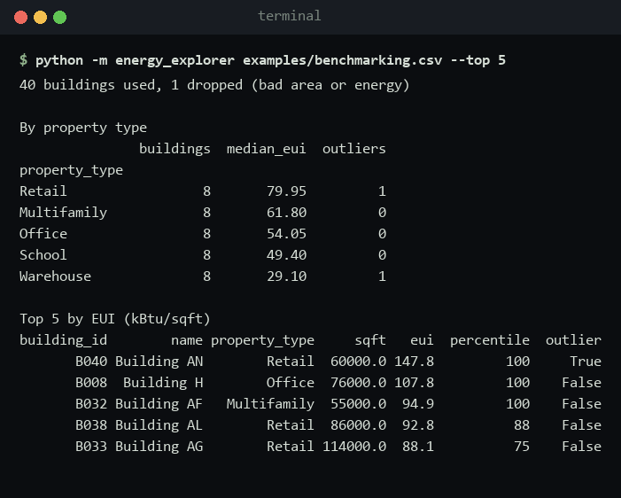

# building-energy-open-data-explorer

[](https://github.com/yassine2med/building-energy-open-data-explorer/actions/workflows/ci.yml)  

Cities publish building energy benchmarking tables, and the first question a facility or sustainability team asks is which buildings use the most energy for their size, compared with similar buildings. This tool loads such a table, computes site energy use intensity (EUI) for every building, ranks each one within its property type, and flags statistical outliers worth an audit.

The bundled data in `examples/` is invented (Building A, Building B and so on). A real city export works once its columns are renamed to the ones listed below.



## What it is for

Cities publish building energy benchmarking tables, but a raw table does not say which buildings are wasteful compared with similar ones. Facility managers, sustainability staff and energy auditors use this tool to compare buildings fairly. They get energy use per square foot for every building, a rank inside its property type, and a flag on statistical outliers that are worth an audit.

## Install

```
git clone <this repo>
cd building-energy-open-data-explorer
pip install -r requirements.txt pytest
```

Python 3.10 or newer. Depends on pandas.

## How to use

| I want to | Command |
|---|---|
| Rank all buildings and show the top 10 | `PYTHONPATH=src python -m energy_explorer examples/benchmarking.csv` |
| Show a different number of top buildings | `PYTHONPATH=src python -m energy_explorer examples/benchmarking.csv --top 5` |
| Look at one property type only | `PYTHONPATH=src python -m energy_explorer examples/benchmarking.csv --type Office` |
| Show help | `PYTHONPATH=src python -m energy_explorer --help` |

On Windows PowerShell set `$env:PYTHONPATH = "src"` first. Required columns: `building_id, name, property_type, sqft, electricity_kwh, gas_therms`.

Example:

```
PYTHONPATH=src python -m energy_explorer examples/benchmarking.csv --top 5
```

Output:

```
40 buildings used, 1 dropped (bad area or energy)

By property type
               buildings  median_eui  outliers
property_type                                 
Retail                 8       79.95         1
Multifamily            8       61.80         0
Office                 8       54.05         0
School                 8       49.40         0
Warehouse              8       29.10         1

Top 5 by EUI (kBtu/sqft)
building_id        name property_type     sqft   eui  percentile  outlier
       B040 Building AN        Retail  60000.0 147.8         100     True
       B008  Building H        Office  76000.0 107.8         100    False
       B032 Building AF   Multifamily  55000.0  94.9         100    False
       B038 Building AL        Retail  86000.0  92.8          88    False
       B033 Building AG        Retail 114000.0  88.1          75    False
```

## How it works

1. Rows with a missing or non-positive floor area, or missing or negative energy, are dropped and counted.
2. EUI is (kWh x 3.412142 + therms x 100) / sqft, in kBtu per square foot.
3. Percentile is the building's rank by EUI inside its own property type (100 is the highest user).
4. A building is an outlier when its EUI is above Q3 + 1.5 x IQR of its property type.
5. The summary table shows count, median EUI and outlier count per type.

## Limits

- Electricity and natural gas only. Steam, chilled water and fuel oil are not read.
- Site energy, not source energy, and no weather normalisation.
- Outlier flags need several buildings per type to mean anything.

## License

MIT, see LICENSE. Author: Yassine Emhamed.
